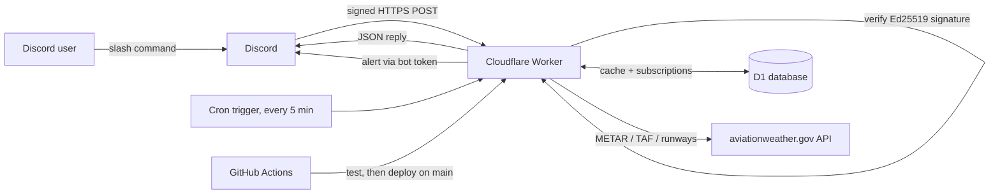

# wxbot: aviation weather for Discord

[](../../actions/workflows/ci.yml)

A Discord bot that turns coded aviation weather into plain English, works out
runway crosswinds, and alerts a channel when an airport's flight conditions
change. It runs serverless on Cloudflare Workers, with no machine to maintain.

> **Not for real flight planning.** This is a hobby and portfolio project. For
> actual flying, use an official briefing source.

## Commands

| Command | What it does |
| --- | --- |
| `/metar KSAN` | Current weather, decoded, with the flight category (VFR, MVFR, IFR, LIFR) |
| `/taf KSAN` | The forecast, split into time periods with a category for each |
| `/crosswind KSAN` | Headwind and crosswind for each runway, using the current wind |
| `/subscribe KSAN` | Post an alert in this channel when the airport drops to IFR or worse, and when it recovers. An optional `condition` picks MVFR or LIFR instead |
| `/unsubscribe KSAN` | Remove that alert |
| `/alerts` | List your alerts |

A raw report like

```
SPECI PADK 170219Z AUTO 15037G48KT 1/4SM -RA FG BKN018 BKN025 OVC033 04/03 A2912
```

becomes "LIFR: low instrument conditions, because of visibility. Wind from 150°
at 37 kt, gusting 48 kt. Visibility 1/4 statute mile. Light rain, fog. Broken
clouds at 1,800 ft..." and so on.

## Architecture



There are two ways into the Worker:

1. **A slash command.** Discord sends an HTTP request. The Worker checks its
   signature, fetches the weather (from the cache if it is fresh), decodes it
   and replies. There is no always-on gateway connection, so nothing runs
   between commands.
2. **The schedule.** Every 5 minutes the Worker fetches the latest report for
   every subscribed airport in one request, compares each flight category with
   the one stored last time, and posts an alert where it changed.

## Code map

| File | Responsibility |
| --- | --- |
| `src/index.ts` | Entry point: request verification, command routing, the scheduled handler |
| `src/verify.ts` | Ed25519 signature check on every Discord request |
| `src/conditions.ts` | Decodes wind, visibility, weather and cloud groups; flight category rules |
| `src/metar.ts` | Current-weather (METAR) decoder |
| `src/taf.ts` | Forecast (TAF) decoder |
| `src/crosswind.ts` | Runway parsing and headwind/crosswind math |
| `src/format.ts` | Plain-English text and Discord embeds |
| `src/alerts.ts` | Who gets notified, and the scheduled check |
| `src/store.ts` | All SQL for subscriptions and station state |
| `src/cache.ts` | Read-through cache for weather API responses |
| `src/weather.ts` | aviationweather.gov client with timeouts |
| `src/discord.ts` | Posting alert messages |
| `src/log.ts` | Structured JSON logging |
| `migrations/` | Database schema |

## Design decisions

- **HTTP interactions instead of a gateway bot.** Slash commands arrive as
  webhooks, so the bot fits a serverless platform, costs nothing when idle and
  has no process to keep alive. The trade-off is a 3-second deadline to reply,
  which is why weather requests time out at 2.5 seconds and responses are cached.
- **A hand-written decoder instead of the API's decoded JSON.** Parsing the raw
  text keeps the logic in this repository where it can be unit tested, and one
  decoder serves both METARs and TAFs. Anything it does not recognise is kept
  in an `unparsed` list instead of throwing, and if a report cannot be decoded
  at all the bot falls back to showing the raw text.
- **No guessing.** If a report lacks visibility or cloud data, the flight
  category is "unknown" rather than assumed.
- **True headings for crosswind.** METAR wind directions are relative to true
  north, while runway numbers are magnetic. The calculation uses each runway's
  true heading, which matters where magnetic declination is large.
- **Forecast groups inherit prevailing conditions.** A `TEMPO` or `BECMG` group
  often lists only what changes, so its flight category is worked out from the
  group plus whatever was in force at the time.
- **Alerts that are safe to re-run.** The stored category is updated only after
  the alert is delivered, so a Discord outage delays an alert instead of losing
  it. If the bot loses access to a channel, that channel's subscriptions are
  removed. Each run has a send budget to stay inside the platform's limits, and
  unfinished airports are picked up by the next run.
- **The cache can fail without breaking commands.** A database error is logged
  and the request goes to the weather service directly.
- **Least privilege and privacy.** The bot requests three permissions (View
  Channels, Send Messages, Embed Links) and no privileged intents. Logs never
  include user IDs. All SQL uses bound parameters.

## Testing

```
npm test          # full suite
npm run typecheck # TypeScript, strict mode
```

The suite covers:

- 50 real METARs from six continents, each with a hand-checked flight
  category, plus constructed edge cases (fractional visibility, obscured sky,
  thunderstorms, missing fields).
- Real TAFs, including a London forecast with ten change groups and a US
  military forecast.
- Boundary values for every flight category threshold.
- Crosswind math against known angles.
- Alert behaviour end to end against a real local D1 database: thresholds,
  recovery alerts, grouping by channel, retries, dead channels and send budget.
- The HTTP layer: signature verification, every command, caching and failures.

## Running it yourself

You need Node.js 22+, a Cloudflare account and a Discord application.

```
npm install
cp .dev.vars.example .dev.vars            # then fill in your Discord credentials
npx wrangler d1 create wxbot              # put the printed database_id in wrangler.jsonc
npx wrangler d1 execute wxbot --remote --file=migrations/0001_init.sql
npx wrangler d1 execute wxbot --remote --file=migrations/0002_cache.sql
npx wrangler secret put DISCORD_PUBLIC_KEY
npx wrangler secret put DISCORD_BOT_TOKEN
npm run register                          # tells Discord about the slash commands
npx wrangler deploy
```

Then paste the Worker's URL into **Interactions Endpoint URL** in the Discord
Developer Portal.

## CI/CD

Every push and pull request runs the typecheck and tests in GitHub Actions.
Pushes to `main` that pass are deployed to Cloudflare automatically. The
workflow needs two repository secrets: `CLOUDFLARE_API_TOKEN` and
`CLOUDFLARE_ACCOUNT_ID`.

## Monitoring

Workers Logs is enabled in `wrangler.jsonc`. Every command and every scheduled
run writes one JSON line (`event`, `command`, `station`, duration in `ms`), and
failures are logged with the error and stack trace. `npx wrangler tail` streams
them live.

## Possible improvements

- Deferred replies, so a slow weather service gets a "thinking..." state
  instead of an error.
- Autocomplete for airport names.
- Decoding of runway visual range and remarks.
- Per-server settings, such as units.

## Data

Weather and airport data come from the
[Aviation Weather Center Data API](https://aviationweather.gov/data/api/),
a free service of the US National Weather Service.
